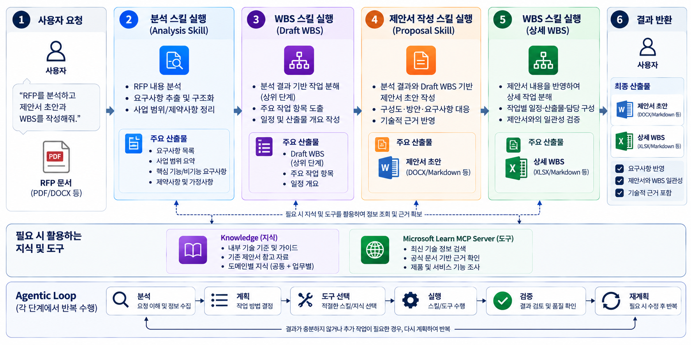
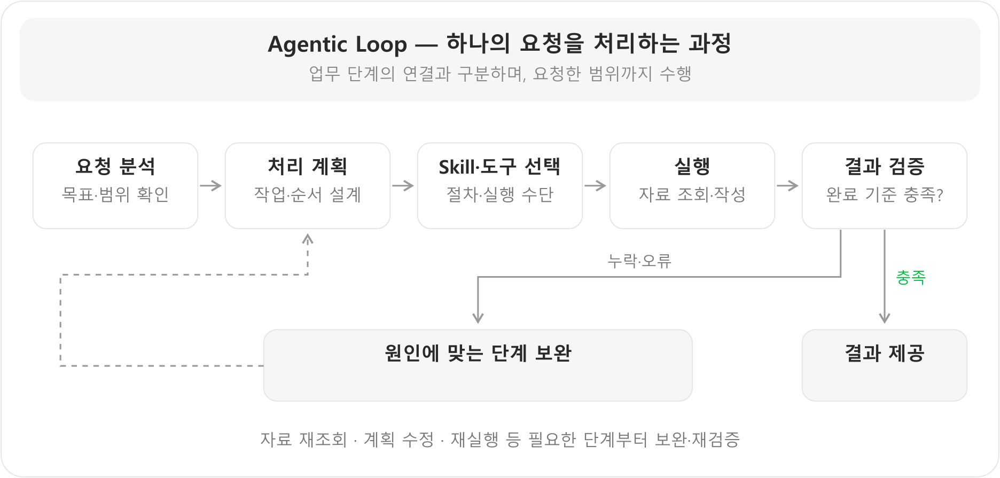

# Microsoft Copilot Studio GHCP Harness Hands-on Lab

<!-- 내용 검토용 초안: 실습 자료는 보완 중이므로 다운로드·참조 링크를 제외했습니다. 실습 자료 작업 완료 후 교안과 자료 링크를 수정하여 재배포할 예정입니다. -->

**RFP 분석 및 제안서·WBS 생성 에이전트 구축**

> 명칭 안내: Microsoft는 2026년 10월 28일 GitHub Copilot harness의 명칭을 Microsoft Copilot harness로 변경한다고 발표했습니다. 이 문서에서는 기존 화면과의 일관성을 위해 **GHCP Harness**라는 이름을 유지합니다. 환경에 따라 새 명칭이 보일 수 있습니다. [공식 명칭 변경 안내](https://www.microsoft.com/en-us/copilot/blog/copilot-studio/the-github-copilot-harness-in-copilot-studio-is-now-the-microsoft-copilot-harness/)

## 1. 학습 목표와 준비사항

RFP 에이전트를 구성하며 다음 내용을 익힙니다.

- 업무를 Skill로 나누고 Instructions로 실행 순서와 공통 원칙을 연결합니다.
- 필요한 Tool·Knowledge를 선택하고, 앞 단계의 결과를 다음 단계에서 재사용하도록 구성합니다.
- 응답·근거·파일과 Activity Trace를 확인해 문제 원인을 찾고 개선합니다.

### 시작 전 확인

| 준비 항목 | 확인할 내용 |
|---|---|
| 계정·환경 | Copilot Studio에 로그인하고, 사용할 환경에서 GHCP 에이전트를 생성·편집할 수 있는지 확인 |
| 연결 기능 | 해당 환경에서 Skill 업로드, MCP 도구 연결, Knowledge 추가를 사용할 수 있는지 확인 |
| 지식 저장소 | Step4의 SharePoint 방식에 사용할 폴더와 접근 권한 준비. 파일 추가 방식은 해당 환경의 지원 여부 확인 |
| 제공 자료 | 아래 자료 목록에서 지침·Skill 등록 파일·지식 샘플·테스트 RFP 확인 |
| 결과 확인 | 생성된 `.pptx`·`.xlsx`를 열어 내용과 서식을 확인할 수 있는 프로그램 준비 |

구체적인 화면 조작과 연결 방법은 각 Step에서 확인합니다.

## 2. 완성할 에이전트와 업무 흐름

RFP에서 요구사항·구축 청사진·추천 인력을 정리하고, 그 결과를 이어받아 제안서와 WBS를 작성하는 에이전트입니다.

**분석 → Draft WBS → 제안서 → 상세 WBS** 순으로 이전 결과를 재사용합니다. Draft WBS는 별도 Excel 파일 없이 중간 계획 데이터로 전달합니다. 청사진과 인력 후보를 일정·수행계획에 연결하고, 최종적으로 표준 양식을 적용한 제안서 `.pptx`와 WBS `.xlsx`를 생성합니다.

## 3. GHCP Harness 개요 

### 3.1 GHCP Harness의 기본 개요와 특징

하네스(Harness)는 AI 모델이 실제 업무를 수행하도록 **모델 호출, 컨텍스트 전달, 도구 실행, 실행 결과 처리**를 조정하는 실행 환경입니다. 모델이 추론과 생성을 담당한다면, 하네스는 그 능력을 업무 수행으로 연결합니다.

**GHCP Harness는 사용자의 목표를 여러 단계로 나누고, 필요한 Skill·도구·지식을 활용하며, 실행 결과에 따라 다음 행동을 조정하는 업무에 적합한 실행 환경**입니다. Instructions로 공통 목표와 행동 원칙을 정하고, Skill로 전문 작업 절차를 제공하며, Tools와 Knowledge로 실행 기능과 근거 자료를 연결합니다. [GHCP Harness 개요](https://learn.microsoft.com/en-us/microsoft-copilot-studio/agents-experience/overview)

주요 특징은 다음과 같습니다.

- **목표 기반의 다단계 작업:** 요청을 처리하기 위한 단계를 구성하고 중간 결과를 후속 작업에 활용합니다.
- **Skill·도구 활용:** 작업 목적에 맞는 Skill을 적용하고, 지식 검색·MCP 등 필요한 도구를 활용합니다.
- **파일 기반 업무:** Word·Excel·PowerPoint·PDF 등 업무 파일을 읽고 생성·편집하는 작업을 지원합니다.
- **실행 결과에 따른 조정:** 도구 응답이나 오류를 확인하고 보완·재시도 등 다음 행동을 조정합니다.

파일 처리 등 하네스별 기능은 [공식 Harness 안내](https://learn.microsoft.com/en-us/microsoft-copilot-studio/harnesses-overview)를 참고합니다.

#### Agentic Loop — 하나의 요청을 해석하고 처리·검증하는 과정

**“첨부한 RFP를 분석해줘”**라는 요청을 예로 들면 다음과 같습니다.

| 단계 | 에이전트의 처리 예 |
|---|---|
| 요청 분석 | 첨부 RFP와 대화 맥락에서 분석 범위·기존 결과 확인 |
| 처리 계획 수립 | 원문 확인 → 요구사항·청사진·인력 후보 정리 → 결과 검증 순서 계획 |
| Skill·도구 선택 | `rfp-analyzer`와 파일 읽기·인력 지식 검색·필요한 기술 조회 도구 선택 |
| 실행 | 원문과 근거 자료를 확인해 분석 결과와 후속 작업에 넘길 정보 작성 |
| 결과 검증 | 요구사항 누락, 청사진 연결, 인력 추천 근거·가용성 상태 확인 |
| 보완·반복 | 누락된 원문이나 부족한 근거를 다시 조회하고 결과 수정·재검증 |

이 과정은 동작을 이해하기 위한 설명 틀입니다. 실행 결과에 따라 필요한 단계부터 보완하며, 처리 계획은 **요청을 수행할 방법을 정하는 것**으로 산출물 안의 구축 청사진 설계와 구분합니다.

**업무 흐름과 Agentic Loop도 구분합니다.** `분석 → Draft WBS → 제안서 → 상세 WBS`는 산출물 간 연결이고, Agentic Loop는 각 요청을 처리하는 계획·실행·검증 과정입니다. RFP 분석만 요청하면 분석 결과를 제공하는 것으로 마치며, WBS·제안서를 자동으로 추가 생성하지 않습니다.

### 3.2 GHCP Harness와 Standard Harness의 차이

두 하네스는 업무를 설계하고 실행하는 중심 방식이 다릅니다. **Standard는 미리 정의한 토픽·규칙·경로가 중심이고, GHCP는 목표를 달성하기 위해 여러 단계를 수행하고 결과에 따라 조정하는 작업이 중심**입니다.

| 비교 관점 | Standard Harness | GHCP Harness |
|---|---|---|
| 설계 중심 | 토픽·규칙·분기 등 명시적인 경로 | 목표·Instructions·Skill을 통한 단계별 업무 수행 |
| 적합한 업무 | 처리 경로가 명확한 반복 문의·구조화된 업무 | 자료와 도구를 연결해 판단해야 하는 복합 업무 |
| 실행 흐름 | 작성자가 정의한 경로를 중심으로 실행 | 목표와 중간 결과에 따라 다음 작업·도구 활용을 조정 |
| 오류·예외 대응 | 사전에 설계한 예외 경로를 중심으로 처리 | 오류 결과를 확인해 재시도·대안 경로 등으로 조정 |
| 파일 업무의 비중 | 정형 대화·규칙 기반 처리에 초점 | 업무 파일의 읽기·생성·편집을 포함한 다단계 처리에 초점 |

이 비교는 각 하네스의 설계 중심과 적합성을 설명합니다. [공식 Harness 비교](https://learn.microsoft.com/en-us/microsoft-copilot-studio/harnesses-overview)

### 3.3 이 에이전트에서 GHCP Harness를 선택한 이유

**이 RFP 에이전트는 GHCP Harness로 구축했습니다.** Standard는 선택 이유를 설명하기 위한 비교 대상이며, 구축 과정에서 함께 사용하지 않았습니다.

1. **최종 산출물까지 이어지는 다단계 흐름이 필요했습니다.**  
분석 결과를 Draft WBS에, 분석·Draft WBS를 제안서에, 그 결과를 상세 WBS에 반영해야 했습니다. 각 단계가 이전 단계의 청사진·범위·인력·일정을 이어받아 작업하는 특성에 GHCP가 적합했습니다.

2. **여러 Skill과 도구를 활용해야 했습니다.**  
분석·WBS·제안서 Skill을 구분하고, 인력 Knowledge 검색·Microsoft Learn MCP·Office 파일 처리 기능을 단계에 맞게 사용해야 했습니다. 결과가 부족하면 근거를 보완하고 해당 작업을 다시 검증하는 흐름도 필요했습니다.

3. **실제 구축에서 PPTX·XLSX 작성과 산출물 품질이 더 좋았습니다.**  
제안서와 WBS 파일을 생성하고 검토한 실무 경험에서 GHCP의 작성 결과와 품질이 더 좋았고, 이를 선택 근거로 반영했습니다.

하위 페이지에서는 이 흐름을 연결하는 구성 방법을 다룹니다. 산출물 품질에 대한 판단은 이번 에이전트의 실제 구축 경험을 기준으로 설명합니다.

## 4. 사용할 자료

이 에이전트는 **`skills-Co`의 지침과 Copy Skill**을 사용합니다. 표준 템플릿을 Skill에 포함하고, 원본을 복사한 뒤 내용을 작성하도록 구성했습니다. `skills` 폴더의 이전 지침과 섞어 등록하지 않습니다.

### 4.1 지침·Skill 등록 파일

| 용도 | 사용할 파일 | 적용 위치 |
|---|---|---|
| 에이전트 지침 | AGENT_지침.md | Step1에서 지침 내용을 입력 |
| 분석 Skill | rfp-analyzer/SKILL.md | Step2에서 `.md` 파일 업로드 |
| 제안서 Skill | rfp-proposal-generator-copy.zip | Step2에서 템플릿을 포함한 `.zip` 그대로 업로드 |
| WBS Skill | rfp-wbs-generator-copy.zip | Step2에서 템플릿을 포함한 `.zip` 그대로 업로드 |

제안서·WBS ZIP에는 `SKILL.md`와 `assets/`의 원본 템플릿이 포함되어 있습니다. 아래 파일은 구성 확인용이며 별도로 Skill에 업로드하지 않습니다.

- **제안서:** Skill 지침, 표준제안서 템플릿_V2.pptx
- **WBS:** Skill 지침, 표준 WBS.xlsx

### 4.2 Knowledge에 연결할 자료

| 분류 | 자료 | 사용 목적 |
|---|---|---|
| 공통 인력 | 기술본부인력관리표.xlsx | 역할·Level·기술 역량에 맞는 후보 추천 |
| 제안 참고 | 한빛푸드 제안서, 노바시온테크그룹 제안서 | 논리 전개·내용 구성 참고. 표준 템플릿과 구분 |
| WBS 참고 | 한빛푸드 WBS, 누리제약 WBS | 작업 분해 참고. 과거 일정·인력·공수를 새 사업에 그대로 적용하지 않음 |

Step4에서 공통·업무별로 연결합니다. 인력 추천의 ‘실명’은 **자료에 실제로 기재된 후보 이름**을 뜻합니다. 이름·경력·가용성을 임의로 만들지 않으며, 운영 자료도 업무 적합성 정보만 사용합니다.

### 4.3 테스트 입력

| 구분 | 자료 | 사용 목적 |
|---|---|---|
| 기본 RFP | RFP-01_물류운영포털.md | Step5에서 분석부터 최종 파일까지의 흐름 확인 |
| 추가 RFP | RFP-02, RFP-03 | 다른 요구사항에서도 역할·근거·완료 기준을 유지하는지 검증 |

## 5. Step별 학습 경로

| 페이지 | 확인할 내용 |
|---|---|
| [Step1. GHCP Harness 에이전트 생성 및 Instructions 작성]({{ '/lab/agent-instructions.html' | relative_url }}) | 에이전트 생성과 전체 목표·범위·공통 원칙 설정 |
| [Step2. Skills 구성]({{ '/lab/skills.html' | relative_url }}) | 업무 분리·입출력·완료 기준 설계와 세 Skill 등록 |
| [Step3. Tools 및 MCP 등록]({{ '/lab/tools-mcp.html' | relative_url }}) | 필요한 행동과 출처를 기준으로 Learn MCP 연결 |
| [Step4. Knowledge 구성]({{ '/lab/knowledge.html' | relative_url }}) | 인력·참고 자료의 역할과 검색 범위 구성 |
| [Step5. 테스트 및 Activity Trace]({{ '/lab/testing.html' | relative_url }}) | 기대 동작과 실행 증거를 대조하고 원인에 맞게 개선 |
| [Step6. 정리 및 마무리]({{ '/lab/wrap-up.html' | relative_url }}) | 설계·검증 기준을 정리하고 자신의 업무에 적용 |

---

[다음: Step1. GHCP Harness 에이전트 생성 및 Instructions 작성 →]({{ '/lab/agent-instructions.html' | relative_url }})
