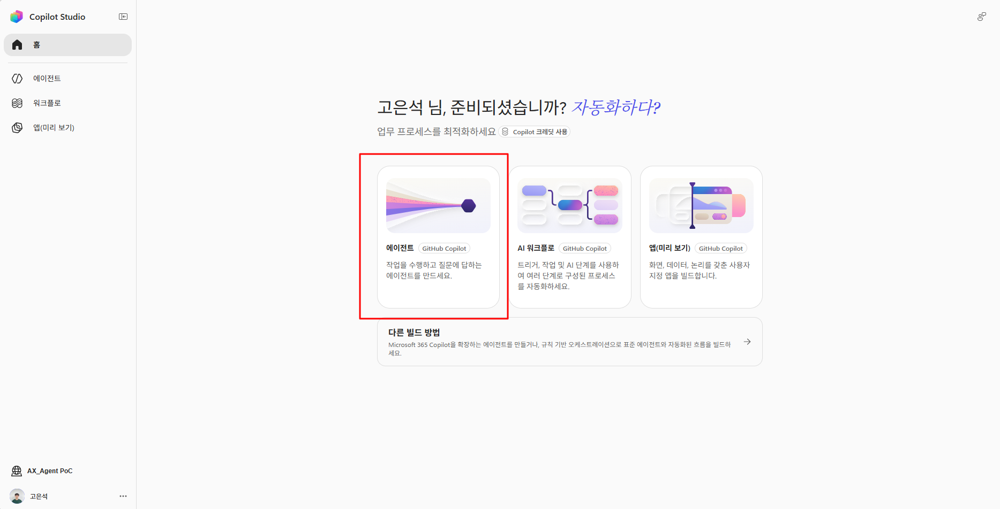
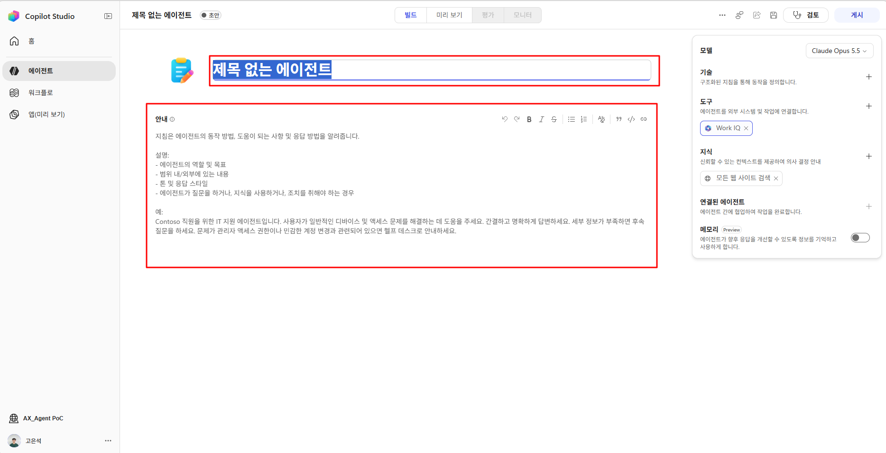
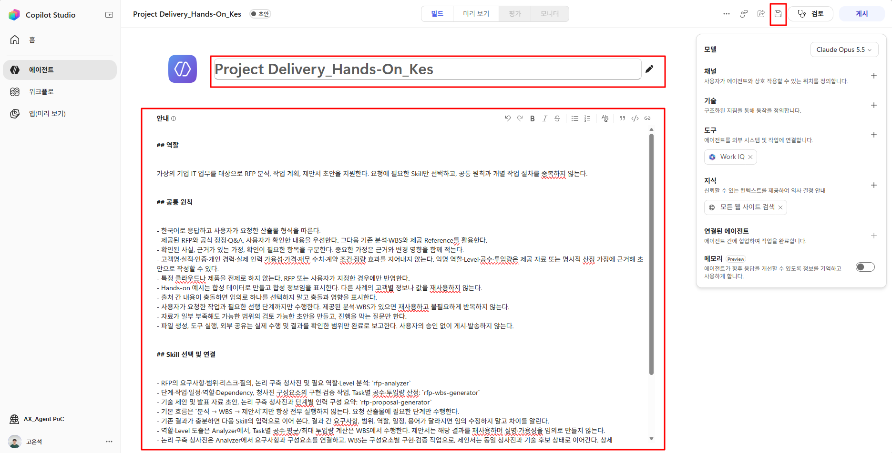

# Step1. GHCP Harness 에이전트 생성 및 Instructions 작성

<!-- 내용 검토용 초안: 실습 자료는 보완 중이므로 다운로드·참조 링크를 제외했습니다. 실습 자료 작업 완료 후 교안과 자료 링크를 수정하여 재배포할 예정입니다. -->

**학습 목표:** GHCP 에이전트를 생성하고 이름·역할·업무 범위·공통 규칙을 입력한 뒤 저장합니다.

### 1. Copilot Studio 홈 화면과 환경 확인

1. [Copilot Studio](https://copilotstudio.microsoft.com/)에 접속하고 에이전트를 만들 권한이 있는 계정으로 로그인합니다.
2. 왼쪽 메뉴에서 **홈**을 선택합니다.
3. 화면 왼쪽 아래에서 사용할 환경을 확인합니다. 이미지의 `AX_Agent PoC`는 예시이며, 계정과 조직 설정에 따라 다른 이름이 표시됩니다.

<!-- 편집 메모: 홈 화면 및 환경 확인 이미지 추가 필요 -->

{: .note }
**확인:** 선택한 환경의 홈 화면과 중앙의 에이전트 카드가 보입니다.

### 2. GitHub Copilot 표시가 있는 에이전트 카드 선택

1. 아래 홈 화면 이미지의 중앙 왼쪽에 있는 **에이전트** 카드를 클릭합니다. 카드 이름 옆에 **GitHub Copilot** 표시가 있습니다.
    

2. 선택 후 아래 이미지처럼 **제목 없는 에이전트**의 편집 화면이 열리는지 확인합니다.
    

GHCP 에이전트를 생성할 때 사용하는 카드입니다. 하단의 **다른 빌드 방법**과 구분해 선택합니다. 명칭 변경이 반영된 환경에서는 카드에 Microsoft Copilot 관련 이름이 표시될 수 있습니다.


### 3. 에이전트 이름 및 지침 입력

#### 에이전트 이름 입력  


1. 위 이미지에서 **상단의 빨간 테두리 안에 있는 `제목 없는 에이전트` 입력란**을 클릭합니다.
2. 기존 문구를 선택하고 아래 이름을 입력합니다. `본인이니셜`은 본인의 이니셜로 바꿉니다.

    ```text
    ProjectDelivery_HandsOn_본인이니셜
    ```

    예를 들어 이니셜이 `KES`이면 `ProjectDelivery_HandsOn_KES`로 입력합니다. 이후 화면 이미지의 `Project Delivery_Hands-On_Kes`는 예시 이름입니다.  
    <!-- 편집 메모: 제목 입력 이미지 추가 필요 -->
    

#### 지침은 어떻게 구성할까?  


지침은 에이전트 전체에 적용할 기준입니다. **어떤 일을 맡길지, 어디까지 수행할지, 어떤 순서로 연결할지**가 먼저 드러나도록 짧게 구성합니다.

| 기본 구조 | 작성할 핵심 | 이렇게 구성한 이유 |
|---|---|---|
| 역할·범위 | 목표와 수행할 업무·제외할 업무 | 요청을 처리할 경계를 명확히 하기 위해 |
| Skill 선택·순서 | 요청별 Skill과 선행 결과 | 필요한 작업만 올바른 순서로 연결하기 위해 |
| 결과 유지 | 단계 간 유지할 청사진·인력·ID 등 | 각 단계가 다른 내용을 새로 만들지 않도록 하기 위해 |
| 공통 원칙 | 출처·가정·개인정보 처리 | 작업마다 판단 기준이 달라지지 않도록 하기 위해 |
| 완료·실패 보고 | 실제 완료의 기준과 미완료 처리 | 초안 작성과 파일 생성 성공을 구분하기 위해 |

작성할 때는 **공통 원칙만 남기고, 판단 가능한 표현을 사용하며, 세부 작업 방법은 Skill에 위임**하는 것이 중요합니다.  
현재 지침의 ‘기존 결과와 충돌하거나 변경이 필요하면 근거·영향을 기록한다. 이름·기술·일정 등 선행 값을 조용히 덮어쓰지 않는다’는 문장은 **단계 전체에 적용할 변경 원칙**입니다. PPTX 복사·편집 같은 수행 방법은 제안서 Skill에 둡니다.

#### 준비된 지침 입력·저장  


1. 중앙의 **안내** 편집 영역을 클릭합니다.  
    <!-- 편집 메모: 지침 추가 이미지 추가 필요 -->
2. 기본 예시 문구를 지우고 에이전트 지침의 내용을 붙여 넣습니다. 위 다섯 구성 요소가 어떻게 반영되어 있는지 확인합니다.
3. 지침의 작업별 Skill 연결이 등록할 분석·WBS 생성·제안서 생성 Skill과 일치하는지 확인합니다.
4. **오른쪽 위 디스크 모양 저장 아이콘**을 클릭합니다. 아래 이미지에서 **검토** 버튼 왼쪽의 빨간 테두리 부분입니다.


 <!-- 편집 메모: 그림 수정 필요 -->

**Step1 완료 체크**

- [ ] 선택한 환경에서 GHCP 에이전트를 생성하고 이름을 지정했습니다.
- [ ] 중앙 안내 영역에 역할·목표·업무 범위·공통 원칙을 입력했습니다.
- [ ] 분석·WBS 생성·제안서 생성 Skill의 선택 조건과 실행 순서를 확인했습니다.
- [ ] 이름과 지침을 저장하고 Skills를 추가할 준비를 마쳤습니다.

---

[← 전체 개요]({{ '/GHCP-Harness-Agent-Lab.html' | relative_url }}) · [Step2. Skills 구성 →]({{ '/lab/skills.html' | relative_url }})
