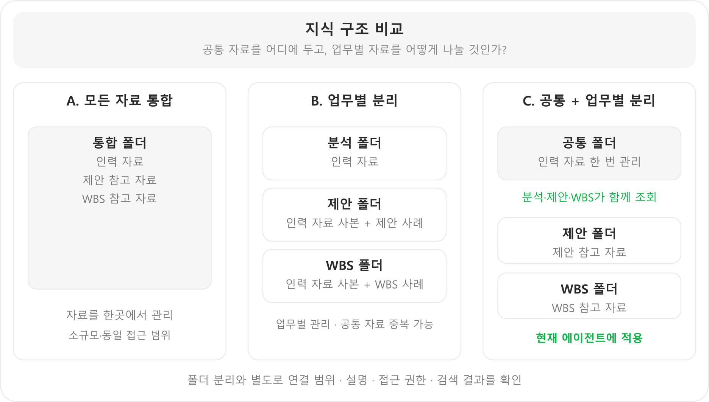
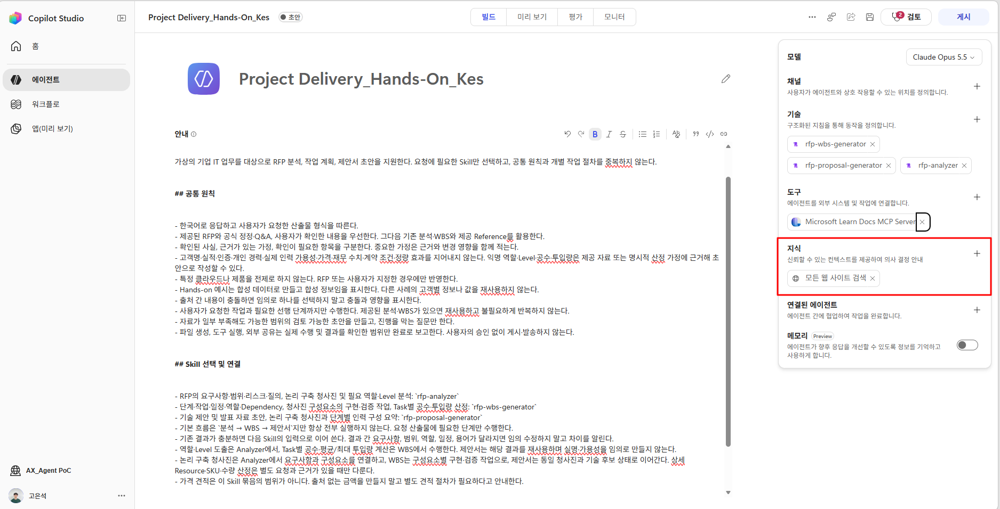
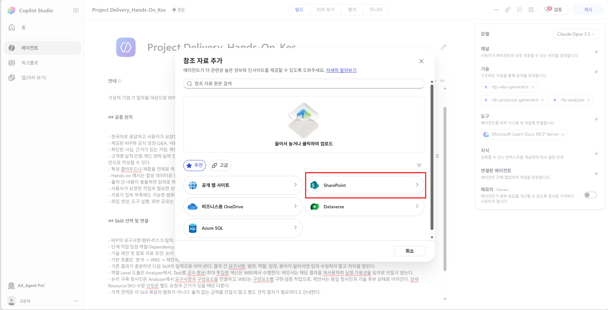
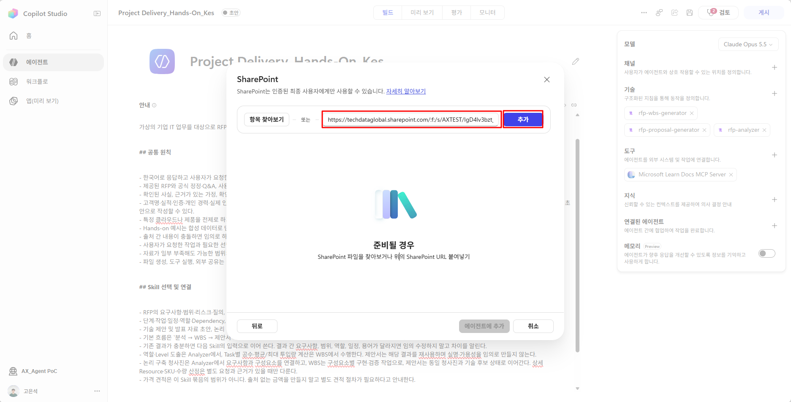
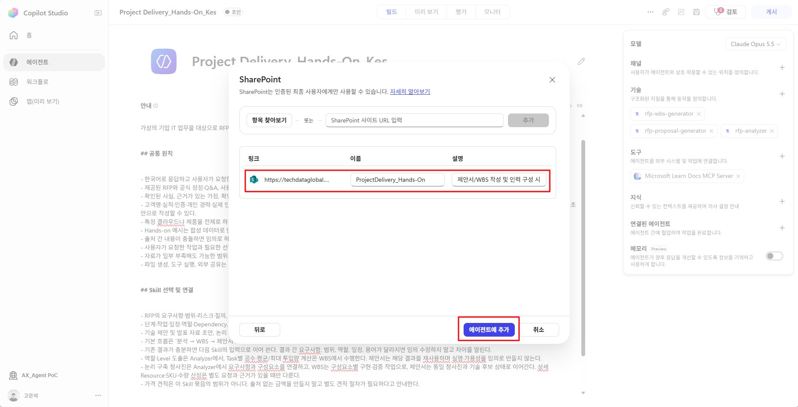
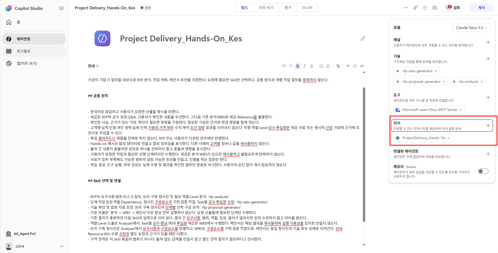

# Step4. Knowledge 구성

{: .warning}
내용 검토용 초안: 실습 자료는 보완 중이므로 다운로드·참조 링크를 제외했습니다. 실습 자료 작업 완료 후 교안과 자료 링크를 수정하여 재배포할 예정입니다. 

**학습 목표:** 판단에 필요한 자료를 공통·업무별로 연결하고, 자료의 내용과 출처가 실제로 조회되는지 확인합니다.

### 1. Knowledge 개요

**Knowledge는 에이전트가 답변과 산출물의 근거로 참조하는 업무 자료**입니다. Skill이 작업 방법을 정의한다면, Knowledge는 판단에 필요한 조직의 정보와 기존 경험을 제공합니다.

### 2. 구성 기준과 이 에이전트의 선택

**에이전트가 답해야 할 질문과 필요한 정보를 먼저 정하고, 그 정보를 가진 자료를 연결합니다.** 이 에이전트는 실제 인력을 추천하고 조직의 업무 경험을 반영해야 하므로 인력관리표와 기존 제안서·WBS를 선택했습니다.

| 실무에서 고려할 기준 | 구성할 때 확인할 내용 | 이 에이전트에 적용한 선택·이유 |
|---|---|---|
| 업무 목적 | 어떤 질문·산출물에 필요한 자료인가? | 실명 후보 추천에는 인력관리표, 제안 논리에는 기존 제안서, 작업 분해에는 기존 WBS 연결 |
| 필요한 정보 | 판단에 필요한 필드가 실제로 있는가? | 이름뿐 아니라 기술·Level·경험이 포함된 인력 자료를 사용해 추천 근거 확보 |
| 자료의 역할 | 확정 기준·표준 양식·참고 사례 중 무엇인가? | 기존 제안서·WBS는 내용 참고용으로 지정. 표준 양식은 문서 생성 Skill에 동봉해 역할 분리 |
| 신뢰성·최신성 | 기준일·유효 버전과 사용 한계를 확인할 수 있는가? | 확인된 경력·자격만 활용하고, 가용성 정보·기준일이 부족하면 배정 가능 여부를 확정하지 않음 |
| 재사용·관리 범위 | 공통으로 쓰는 자료와 업무별 자료를 어떻게 나눌 것인가? | 여러 Skill이 사용하는 인력은 공통으로, 제안·WBS 사례는 업무별로 구분해 중복 관리 감소 |
| 검색·접근 범위 | 필요한 사용자가 필요한 내용과 출처를 찾을 수 있는가? | 용도별 지식 이름·설명과 연결 범위를 정하고, 실제 후보 이름·추천 근거가 함께 검색되는지 확인 |

예를 들어 인력 이름만 검색되면 ‘누가 적합한가’를 판단하기 어렵습니다. **추천에 필요한 역량 필드가 있는 자료를 선택하고, 해당 근거까지 조회되는지 확인**해야 합니다. 같은 이유로 제안서 사례에는 ‘내용 구성 참고용’이라는 설명을 붙여 과거 실적·금액·일정이 새 사업의 사실로 사용되지 않게 합니다.

다른 업무에서도 예상 질문→필요 정보→원본 자료→사용 목적·범위→검색 검증 순으로 구성합니다. 자료량과 재사용·관리 범위를 기준으로 아래 구조를 선택합니다.

### 3. 지식 구조 비교



| 구조 | 장점 | 단점·주의 | 선택 기준 |
|---|---|---|---|
| A. 모든 자료 통합 | 가장 빠르게 구성, 소규모 검증에 편리 | 목적별 구별·권한·버전 관리가 어려워질 수 있음 | 자료가 적고 접근 권한이 동일할 때 |
| B. 업무별 분리 | 업무별 검색 범위·담당자·권한 구분이 쉬움 | 공통 인력·표준 자료가 중복될 수 있음 | 자료와 관리 조직이 업무별로 독립적일 때 |
| **C. 공통 + 업무별 분리** | 공통 데이터 재사용과 업무별 목적 구분을 함께 지원 | 연결 항목·설명·접근 권한을 각각 관리해야 함 | **여러 Skill이 같은 인력과 기준을 사용하는 에이전트** |

이 에이전트는 여러 Skill이 같은 인력 자료를 사용하므로 **공통 자료는 한곳에 두고 제안·WBS 참고 자료는 업무별로 구분**했습니다. 중복 관리를 줄이면서 자료의 사용 목적을 명확히 하기 위한 구성입니다.

{: .warning }
폴더를 나누는 것만으로 검색 정확도나 권한 격리가 보장되지는 않습니다. **연결 범위, 지식 이름·설명, 실제 사용자의 접근 권한, 검색 결과**를 함께 확인합니다.

### 4. 공통·업무별 지식 연결

SharePoint 자료를 공통 인력·제안 참고·WBS 참고 용도로 구분해 연결합니다. 아래는 폴더 구성 예이며, 접근 가능한 저장소의 실제 폴더를 선택합니다.

```text
ProjectDelivery-HandsOn/
├─ Common/        ← 기술본부인력관리표.xlsx
├─ Proposal/      ← 제안서 참고 샘플 2개
└─ WBS/           ← WBS 참고 샘플 2개
```

연결 전에 접근 가능한 SharePoint 저장소에 위 폴더를 만들거나 기존 폴더를 선택하고, 제공된 샘플을 해당 위치에 업로드합니다.

| 준비할 폴더 | 배치할 제공 자료 |
|---|---|
| `Common` | 기술본부인력관리표.xlsx |
| `Proposal` | 한빛푸드 제안서, 노바시온테크그룹 제안서 |
| `WBS` | 한빛푸드 WBS, 누리제약 WBS |

표준 템플릿은 Skill ZIP에 포함되어 있으므로 이 참고 자료 폴더에 넣지 않습니다. 배치한 문서를 사용하는 계정으로 열 수 있는지 확인한 뒤, 아래 이름·설명으로 폴더를 연결합니다.

| 지식 이름 예 | 설명에 입력할 내용 |
|---|---|
| `PD 공통 — 인력` | RFP에 맞는 역할·Level·기술 역량 후보를 추천할 때 사용하는 인력 자료. 가용성 정보가 없으면 확인 중으로 표시. |
| `PD 제안 — 참고 사례` | 제안 논리와 구성 참고용. 표준 템플릿이 아니며 다른 고객·실적·금액을 복사하지 않음. |
| `PD WBS — 참고 사례` | 작업 분해·Dependency 참고용. 새 사업의 날짜·인력·공수 확정 근거로 자동 전용하지 않음. |

1. **빌드 → 지식(Knowledge) 옆 +**를 선택해 지식 추가 메뉴를 엽니다.

    

2. 지식 원본으로 **SharePoint**를 선택합니다.

    

3. `항목 찾아보기` 또는 URL 입력으로 준비한 폴더를 선택합니다. 주소는 실제 SharePoint 폴더에서 확인한 값을 사용합니다.

    

4. 선택한 자료의 **이름과 설명**에 위 표의 용도를 입력하고 에이전트에 추가합니다. 공통 인력·제안 참고·WBS 참고 중 어떤 판단에 사용할 자료인지 구분합니다.

    

5. 지식 목록에 추가된 항목의 이름과 연결 범위를 확인합니다.

    

6. 나머지 폴더도 같은 방식으로 연결합니다. 세 지식 연결을 모두 추가한 뒤 각 범위의 문서가 검색되는지 확인합니다. 인력관리표에서는 실제 시트의 기술·Level·경험을 조회하고, 없는 가용성 정보는 추정하지 않습니다.

화면은 지식 1개를 연결한 예시입니다. 같은 방식으로 용도별 범위를 연결합니다. 파일 추가 기능을 제공하는 환경에서는 같은 분류·설명으로 등록할 수 있습니다.

SharePoint 원본을 변경했다고 즉시 검색 결과가 갱신되었다고 가정하지 말고 검색으로 확인합니다.

**지식 조회 확인 예시:** “공통 인력 지식에서 Power Platform·API 연계·문서 추출에 적합한 후보를 찾아, 이름·원문 Level·업무 근거·출처를 보여줘. 가용성을 확인하지 못하면 확인 중으로 표시해.”

**다음 단계로 넘어가기 전:** 세 지식 연결의 범위·용도를 확인하고, 인력 조회에서 자료에 있는 후보 이름과 해당 근거가 함께 반환되는지 확인합니다. 이름만 검색되고 역량 필드가 없으면 원문·관련 행을 추가 조회합니다.

---

<nav class="lab-page-nav" aria-label="페이지 이동">
  <a class="lab-page-nav__prev" href="{{ '/lab/tools-mcp.html' | relative_url }}" rel="prev">이전</a>
  <a class="lab-page-nav__home" href="{{ '/' | relative_url }}">홈</a>
  <a class="lab-page-nav__next" href="{{ '/lab/testing.html' | relative_url }}" rel="next">다음</a>
</nav>
