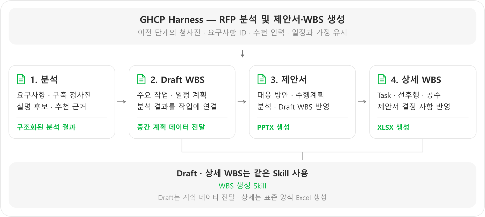
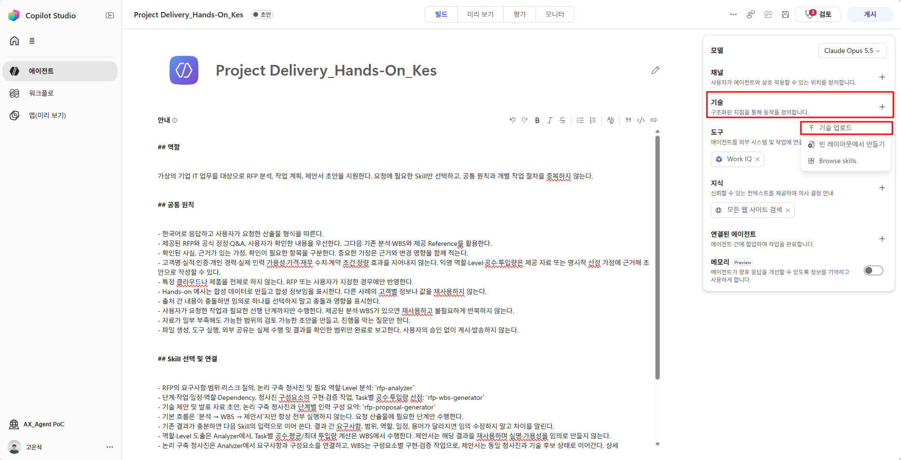
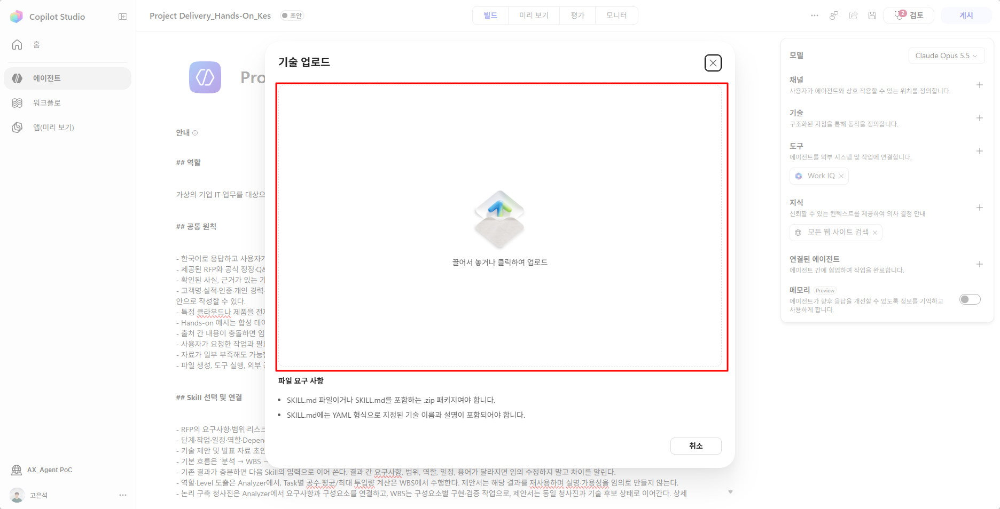
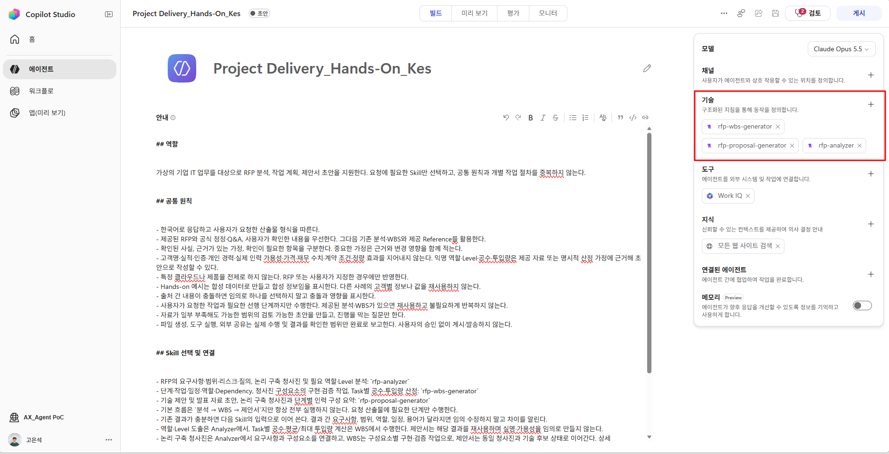
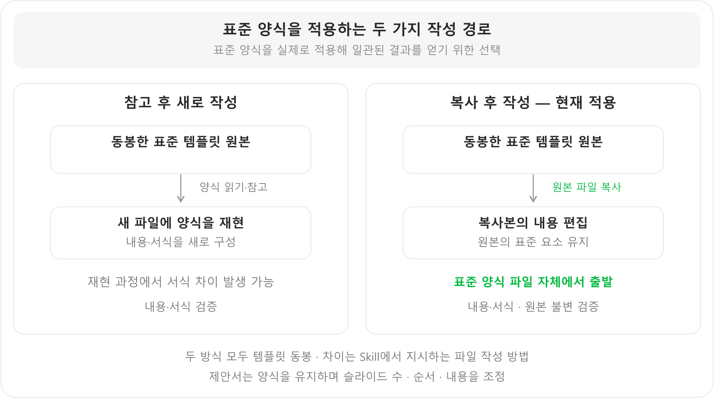

# Step2. Skills 구성

{: .warning}
내용 검토용 초안: 실습 자료는 보완 중이므로 다운로드·참조 링크를 제외했습니다. 실습 자료 작업 완료 후 교안과 자료 링크를 수정하여 재배포할 예정입니다. 

**학습 목표:** 업무별 입력·출력·완료 기준을 구분하고, 이전 결과를 이어 쓰도록 세 Skill을 등록합니다.

### 1. Skill 개요

Skill은 **하나의 업무를 수행하는 방법을 묶은 재사용 단위**입니다. 이 에이전트는 분석·WBS·제안서를 각각 다른 Skill로 구성합니다. [공식 Skill 개요](https://learn.microsoft.com/en-us/microsoft-copilot-studio/agents-experience/skills-overview)

### 2. 업무 분리 기준과 현재 에이전트의 구성

**하나의 명확한 목적과 완료 기준을 하나의 Skill로 묶습니다.** 작은 Task마다 Skill을 만들거나, 여러 산출물의 작성 방법을 한 Skill에 모두 넣지 않습니다.

| Skill | 맡은 작업 | 분리한 이유 |
|---|---|---|
| 분석 Skill | 요구사항·청사진·인력 추천 정리 | 모든 후속 작업이 사용할 기준을 한 번 정하기 위해 |
| WBS 생성 Skill | 분석 결과를 작업·일정·담당자로 구체화 | 일정·공수 계획의 책임을 분리하기 위해 |
| 제안서 생성 Skill | 분석·WBS를 고객에게 설명할 제안서로 구성 | 제안 표현을 바꾸면서 범위·일정까지 다시 만들지 않도록 하기 위해 |

이렇게 나누면 제안서의 구성이나 템플릿을 수정할 때 인력 분석·일정 산정까지 함께 고칠 필요가 줄어듭니다. 각 Skill에는 **해당 작업에 필요한 내용만** 넣고 다른 Skill의 수행 방법을 복사하지 않습니다.

### 3. 각 Skill의 업무 정의

Skill을 작성할 때는 긴 지시문보다 다음 구조부터 정합니다.

| 기본 구조 | 작성할 핵심 | 중요한 이유 |
|---|---|---|
| 이름·설명 | 어떤 요청에 사용할지 | 에이전트가 적절한 Skill을 선택하는 기준 |
| 입력·범위 | 필요한 선행 결과와 맡지 않을 작업 | 입력 누락과 역할 중복 방지 |
| 수행 절차 | 해당 업무에 필요한 핵심 작업 | 업무를 반복 가능한 방식으로 수행 |
| 출력·인계 | 결과 형식과 다음 작업에 넘길 정보 | 후속 단계가 바로 재사용할 수 있도록 구성 |
| 검증·예외 | 완료 기준과 부족·오류 처리 | 생성 결과의 품질과 실제 완료 여부 확인 |

Skill 정의 문서에는 목적·입력·절차·출력·검증 기준을 작성합니다. 템플릿 등 필요한 지원 자료를 함께 구성하고, 정의 문서에서 사용 방법을 명시합니다.

```text
Skill 구성
├─ 정의 문서      ← 이름·설명 + 입력·절차·출력·검증
└─ 지원 자료      ← 필요한 경우 템플릿 등 포함
```

**제안서 생성 Skill의 정의 예시**

| 항목 | 현재 에이전트에 적용한 내용 |
|---|---|
| 입력 | RFP 분석 결과와 Draft WBS |
| 수행 절차 | 요구사항 대응·청사진·수행계획을 제안 내용으로 구성 |
| 출력 | 표준 양식을 적용한 `.pptx` 파일 |
| 완료 기준 | 기존 분석·WBS와 내용이 일치하고 파일·서식 검증 통과 |

이처럼 ‘제안서를 잘 작성한다’는 목표를 **무엇을 받아 어떻게 처리하고, 어떤 결과를 언제 완료로 볼 것인지**로 구체화합니다. 세부 방법은 제안서 생성 Skill에 정의하고, 에이전트 지침에는 같은 절차를 반복하지 않습니다.

### 4. 연결은 ‘다음 Skill이 쓸 수 있는 결과’로 설계

Skill을 나누기만 하면 다음 단계에서 이전 정보를 잃을 수 있습니다. **앞 단계의 출력이 다음 단계의 입력이 되도록** 함께 설계해야 합니다.



Draft WBS는 주요 작업·일정을 구조화된 중간 계획 데이터로 정리해 제안서에 전달하고, 상세 WBS는 제안서의 결정 사항을 반영해 Task·선후행·공수를 구체화합니다. **같은 WBS Skill이 모드에 따라 입력·작성 수준·출력을 구분하며, 상세 단계에서 표준 양식의 `.xlsx`를 생성합니다.** 분석 결과는 모든 후속 단계에서 함께 사용합니다.

유지할 핵심은 요구사항·구성요소 ID, 청사진, 후보 이름·Level·가용성, 일정과 가정·출처입니다. 상세 인계 형식은 각 Skill에 두고, 에이전트 지침에는 ‘이전 결과를 전달하고 유지한다’는 원칙만 둡니다.

기존 결과를 읽을 수 있으면 위치·버전을 연결하고 변경분을 전달합니다. 읽을 수 없다면 필요한 값을 직접 포함합니다. 파일명만 넘기거나 역할명만 남겨 추천 실명이 사라지지 않도록 합니다.

### 5. Skill 등록

등록할 Skill에 따라 업로드 파일 형식이 다릅니다.

| 등록할 Skill | 업로드할 파일 | 포함 내용 |
|---|---|---|
| 분석 Skill | 지침 문서(`.md`) | 분석 지침 |
| 제안서 생성 Skill | 템플릿 포함 패키지(`.zip`) | 지침 + PowerPoint 템플릿 |
| WBS 생성 Skill | 템플릿 포함 패키지(`.zip`) | 지침 + Excel 템플릿 |

{: .note }
`.zip`은 템플릿을 함께 전달하기 위한 **Skill 등록 패키지**입니다. 생성 결과물인 `.pptx`·`.xlsx`와 구분합니다.

#### 5.1 분석 Skill 등록 — `.md` 파일

1. **빌드 → 기술(Skills) 옆 + → 기술 업로드**를 선택합니다.
    
2. 파일을 끌어 놓거나 업로드 영역을 클릭해 제공된 분석 Skill의 지침 문서(`.md`)를 선택합니다. **분석 Skill은 별도 동봉 파일 없이 `.md` 파일 하나를 업로드**합니다.
    
3. 이름·설명이 인식되고 목록에 분석 Skill이 표시되는지 확인합니다.
    <!-- 편집 메모: - 인식된 화면 캡쳐 추가하기 -->

#### 5.2 제안서 Skill 등록 — 템플릿을 포함한 `.zip` 파일

1. **빌드 → 기술(Skills) 옆 + → 기술 업로드**를 다시 선택합니다.
2. 제공된 제안서 생성 Skill 패키지를 선택하고, **압축을 풀지 않은 `.zip` 파일 그대로 업로드**합니다. 분석 Skill과 달리 지침 문서만 선택하지 않습니다.
3. 목록에 제안서 생성 Skill이 표시되는지 확인합니다.
4. 패키지에는 아래 두 파일이 포함됩니다. 실행 시 동봉된 원본 템플릿을 복사해 제안서 양식을 유지합니다.

```text
제안서 생성 Skill 패키지(.zip)
├─ 업무 수행 지침(.md)
└─ 표준 제안서 템플릿(.pptx)
```

**확인:** 업로드 형식은 `.zip`이고, 생성할 최종 산출물은 `.pptx`입니다.

{: .warning }
`.md` 파일만 업로드하면 Skill이 지시하는 동봉 템플릿을 전달할 수 없습니다.

#### 5.3 WBS Skill 등록 — 템플릿을 포함한 `.zip` 파일

1. 같은 **기술 업로드** 메뉴를 엽니다.
2. 제공된 WBS 생성 Skill 패키지를 선택하고, **압축을 풀지 않은 `.zip` 파일 그대로 업로드**합니다.
3. 목록에 WBS 생성 Skill이 표시되는지 확인합니다.
4. 패키지에는 아래 두 파일이 포함됩니다. 실행 시 동봉된 원본 템플릿을 복사해 WBS를 작성합니다.

```text
WBS 생성 Skill 패키지(.zip)
├─ 업무 수행 지침(.md)
└─ 표준 WBS 템플릿(.xlsx)
```

**확인:** 업로드 형식은 `.zip`이고, 상세 WBS의 최종 산출물은 `.xlsx`입니다. Draft WBS는 구조화된 표·인계 데이터로 전달합니다. 기술 목록의 세 이름이 에이전트 지침의 라우팅과 일치하는지 확인합니다.


<!-- 스킬 확인 화면 수정 필요 -->

기술 목록에 분석·제안서 생성·WBS 생성 Skill이 등록되어 있는지 확인합니다. 캡처의 표시 이름은 예시이며, 실제 등록된 Skill의 이름·설명과 에이전트 지침의 작업별 연결이 일치하는지 확인합니다. 사용할 템플릿 방식에 맞는 Skill만 등록하면 선택 혼선을 줄일 수 있습니다.

**다음 단계로 넘어가기 전:** 세 Skill의 등록 이름과 지침의 라우팅이 일치하고, 제안서·WBS ZIP에 원본 템플릿이 포함되어 있는지 확인합니다.

### 6. 지침과 Skill의 역할 구분

**지침은 전체 업무의 목표·공통 원칙·실행 순서를, Skill은 특정 작업의 수행 방법을 담당합니다.** 같은 방법을 두 곳에 적으면 변경 시 서로 다른 규칙이 남을 수 있습니다.

| 구분 | 현재 에이전트와 제안서 생성 Skill의 예 |
|---|---|
| 에이전트 지침 | 제안서 요청에는 해당 Skill을 사용하고 이전 분석·Draft WBS의 청사진·인력·일정을 유지 |
| 제안서 생성 Skill | 동봉 PPTX를 복사해 양식을 유지하고 제안에 맞게 슬라이드를 구성한 뒤 내용·서식을 검증 |

**설계 시 확인할 세 가지:** 
1. 맡은 작업이 명확한가 
2. 입력·출력·완료 기준이 있는가, 
3. 지침이나 다른 Skill과 중복·충돌하지 않는가.  
    
원문의 길이보다 이 구조와 책임 구분이 중요합니다.

### 설계 시 고려할 점 — 템플릿 구성

아래는 실제 업무에서 템플릿 지정·작성 방식을 비교하며 얻은 경험입니다. 에이전트 구축 절차와 별도로, 양식 정확도와 관리 편의성 사이의 선택을 판단할 때 참고할 수 있습니다.

#### 1. 템플릿 지정 방식별 장단점

템플릿을 **어디에 두고 지정하는지**에 따라 세 방식으로 구분합니다. 양식의 복잡도와 변경 빈도, 원본 접근 경로를 기준으로 선택합니다.

| 방식 | Skill에서 지정하는 방법 | 장점 | 단점·트레이드오프 |
|---|---|---|---|
| A. Skill 지침에 직접 정의 | 열·좌표·폰트·수식 등을 Skill 본문에 기술 | 필요한 규격을 세밀하게 표현 가능 | 서식 표현이 복잡하고 지침이 길어져 작성·수정이 어려움 |
| **B. Skill에 템플릿 동봉** | 패키지에 템플릿 파일을 포함하고 지침에서 사용하도록 지정 | 복잡한 서식 정의 없이 템플릿과 지침을 함께 제공 | 스킬 패키지 제한, 템플릿 변경 시 스킬 패키지 갱신 필요 |
| C. 외부 저장소·지식 참조 | 지식의 이름·설명으로 양식을 선택하고 원본 확보 | 템플릿을 중앙에서 관리·교체하기 편리 | 검색·버전 선택·원본 가져오기가 정확도에 영향. 권한·인증 설계 필요 |


#### 2. 표준 양식을 일관되게 적용하기 위한 원본 복사

**목표는 제안서와 WBS에 회사 표준 양식을 실제로 적용해, 반복 생성해도 일관된 형식의 결과를 받는 것이었습니다.** 같은 템플릿을 동봉해도 Skill에서 파일 작성 방법을 어떻게 지시하는지에 따라 차이가 있었습니다.



참고 방식은 서식을 재현하면서 원본과 차이가 생길 수 있었습니다. 현재는 **원본 복사본에서 내용을 작성하고, 원본의 표준 요소가 유지되는지 검증**하도록 구성했습니다.

제안서는 양식을 유지하면서 슬라이드 수·순서·내용을 조정합니다. 핵심은 **표준 양식을 제대로 적용한 문서와 일관된 결과를 얻는 것**입니다.

---

<nav class="lab-page-nav" aria-label="페이지 이동">
  <a class="lab-page-nav__prev" href="{{ '/lab/agent-instructions.html' | relative_url }}" rel="prev">이전</a>
  <a class="lab-page-nav__home" href="{{ '/' | relative_url }}">홈</a>
  <a class="lab-page-nav__next" href="{{ '/lab/tools-mcp.html' | relative_url }}" rel="next">다음</a>
</nav>
