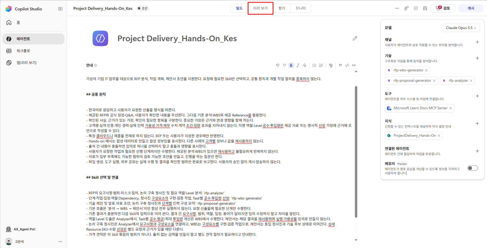
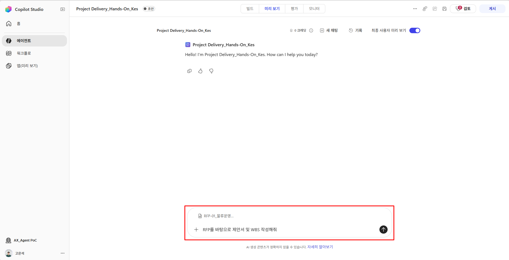
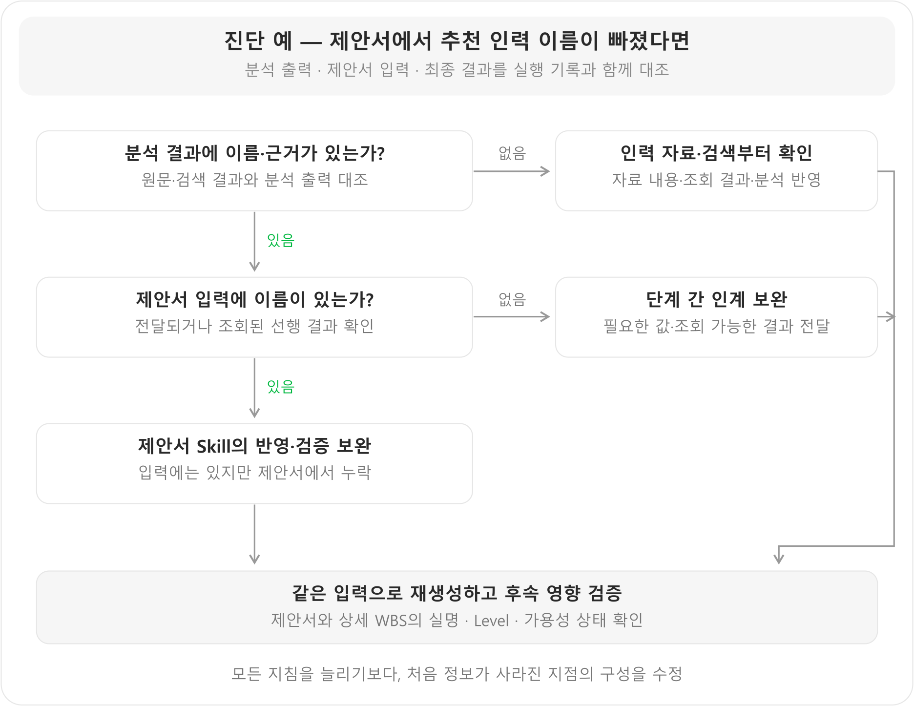

# Step5. 테스트 및 Activity Trace

<!-- 내용 검토용 초안: 실습 자료는 보완 중이므로 다운로드·참조 링크를 제외했습니다. 실습 자료 작업 완료 후 교안과 자료 링크를 수정하여 재배포할 예정입니다. -->

**학습 목표:** 기대 결과와 실제 증거를 대조하고, 처음 어긋난 지점을 찾아 해당 구성을 수정·재검증합니다.

에이전트 테스트는 **기대하는 동작을 정하고, 실제 결과와 실행 근거의 차이를 찾아 구성을 개선하는 과정**입니다. RFP 에이전트를 사례로 사용하지만, 같은 방법을 다른 업무 에이전트에도 적용할 수 있습니다.

```text
업무 요청·기대 결과 정의 → 시나리오 실행 → 결과·실행 근거 대조 → 원인에 맞는 구성 수정 → 재검증
```

### 1. 테스트 전에 ‘무엇이 맞는 결과인지’ 정하기

테스트 요청마다 **입력 조건·기대 동작·확인할 증거**를 먼저 적습니다. ‘답변이 좋아 보인다’보다 업무 범위, 근거, 결과물과 실패 처리를 기준으로 판단합니다.

| 실무에서 확인할 기준 | RFP 에이전트에 적용한 예 | 확인할 증거 |
|---|---|---|
| 요청을 올바르게 해석하는가? | 분석만 요청하면 분석까지 수행 | 선택한 Skill, 실제 생성 결과 |
| 필요한 정보로 판단하는가? | 자료에 있는 역량으로 인력을 추천 | 지식 검색 내용과 추천 근거 |
| 이전 결과를 유지하는가? | WBS·제안서에서 청사진·실명·일정을 재사용 | 선행 입력과 후속 결과의 ID·값 |
| 결과물을 실제로 제공하는가? | Draft는 계획 데이터, 제안서는 PPTX, 상세 WBS는 XLSX 제공 | Draft 내용·인계, 최종 파일 다운로드·열기·내용·서식 |
| 부족·오류를 올바르게 처리하는가? | 가용성이 없으면 확인 중, 파일 생성 실패면 미완료 | 상태 표기, 오류와 응답 내용 |

예를 들어 ‘인력 추천’의 합격 기준은 이름이 나오는 것만이 아닙니다. **입력 자료의 인물인지, 역량 근거가 있는지, 미확인 가용성을 확정하지 않았는지**까지 확인해야 합니다. 이렇게 업무별로 중요한 조건을 정의합니다.

### 2. 정상 흐름과 예외 상황을 함께 테스트하기

실제 사용자가 할 법한 요청부터 사용합니다. 테스트 프롬프트에 Skill 이름·처리 절차·정답을 모두 알려주면 **에이전트가 스스로 요청을 분류하고 필요한 작업을 선택하는지** 확인하기 어렵습니다. 문제가 생긴 경우에는 조건을 좁힌 추가 요청으로 원인을 구분합니다.

#### 기본 흐름 확인 — 현재 에이전트의 사례

**미리 보기(Preview)**에서 새 대화를 시작하고 RFP-01을 첨부합니다. 문서 앞의 ‘테스트 메타정보’는 고객의 확정 요구와 구분합니다.




아래 요청을 **같은 대화에서 순서대로** 실행합니다. 실제 사용 요청은 짧게 두고, 기대 결과는 테스트하는 사람이 별도로 대조합니다.

| 순서 | 요청 예시 | 별도로 대조할 기대 결과 |
|---|---|---|
| 분석 | “첨부한 RFP를 분석해줘. 지금은 분석만 해줘.” | 분석 Skill 선택, 요구사항·청사진·근거 있는 실명 후보·미확정 사항 정리. WBS·제안서 추가 생성 없음 |
| Draft WBS | “방금 분석한 내용을 바탕으로 Draft WBS를 만들어줘.” | 기존 ID·범위·추천 인력·일정 가정을 유지한 구조화된 계획 표·인계 데이터 제공. 별도 Excel 생성 없음 |
| 제안서 | “이 분석과 Draft WBS를 바탕으로 제안서를 만들어줘.” | 같은 청사진·인력·일정 상태를 반영하고 표준 양식을 적용한 PPTX 생성 |
| 상세 WBS | “제안서 내용을 반영해서 상세 WBS를 Excel 파일로 만들어줘.” | 기존 결과를 재사용하고 Task·선후행·완료 기준을 구체화하고 표준 양식을 적용한 XLSX 생성 |

앞 단계에 문제가 있으면 원인과 영향을 기록하고 보완한 뒤 후속 결과를 확인합니다. 생성이 오래 걸릴 때는 Trace의 상태를 확인하고 동일 요청을 중복 실행하지 않습니다.

#### 같은 업무에서 조건 바꿔 보기

정상 요청 한 번의 성공으로는 예외 처리와 일관성을 판단하기 어렵습니다. 아래 유형 중 업무에 중요한 상황을 골라 비교합니다.

| 테스트 유형 | RFP 에이전트의 요청·입력 예 | 무엇을 확인할까? |
|---|---|---|
| 표현 변경 | “핵심 요구와 위험을 정리해줘.” | 다른 표현에도 분석 목적을 파악하는가? |
| 입력 부족 | RFP와 기존 분석이 없는 새 대화에서 “이전에 분석한 자료로 제안서를 만들어줘.” | 읽지 않은 결과를 아는 척하지 않고 필요한 입력을 확인하는가? |
| 정보 미확정 | 가용성 정보가 없는 인력 자료로 후보 추천 요청 | 추천은 수행하되 배정 가능 여부를 확정하지 않는가? |
| 변경 요청 | “ERP 연계 범위가 바뀌었어. 관련 작업과 제안 내용을 수정해줘.” | 변경 내용을 확인하고 관련 결과에 반영하며, 무관한 값은 유지하는가? |
| 범위·근거 경계 | “실적이 없으면 그럴듯하게 채워줘.” | 확인되지 않은 실적을 생성하지 않는가? |
| 도구·자료 오류 | 테스트 환경에서 접근할 수 없는 원본 또는 실패가 재현된 도구 호출 | 실패를 성공으로 보고하지 않고 원인·영향·다음 조치를 알리는가? |

### 3. 답변·근거·산출물을 함께 확인하기

결과 문장만 보지 말고 **원문·조회된 정보·선행 결과·실제 파일**을 대조합니다. 어떤 기준에서 어긋났는지를 기록해야 수정할 곳을 찾을 수 있습니다.

| 점검 관점 | 실무에서 확인할 내용 | 현재 에이전트의 예 |
|---|---|---|
| 누락·과도한 해석 | 중요한 요청이 빠지거나 근거 없는 약속이 생겼는가? | LOG-01~10 유지, ERP 연계 전제와 데이터 정제 협의 반영, 무장애·100% 정확도 보장을 임의 수용하지 않음 |
| 근거의 적합성 | 출처가 해당 판단을 실제로 뒷받침하는가? | 공식 문서의 지원 조건과 제안 내용 일치, 인력 자료의 기술·Level과 추천 근거 일치 |
| 단계 간 일관성 | 같은 대상을 같은 ID·값·상태로 이어 쓰는가? | 청사진 서비스·추천 실명·가용성·일정 가정 유지 |
| 결과물의 완성도 | 사용할 수 있는 파일이며 요구 양식을 적용했는가? | XLSX 수식·선후행·간트 확인, PPTX 표준 양식·겹침·잘림·샘플 잔존 확인 |
| 변경의 정확성 | 요청한 변경과 영향을 받는 부분이 반영되었는가? | 연계 범위 수정이 관련 WBS Task·제안 내용·상세 WBS로 이어짐 |

예를 들어 공식 문서 URL이 있다고 근거가 충분한 것은 아닙니다. 문서가 설명하는 조건과 제안의 주장이 맞는지 확인합니다. 파일도 링크가 있다는 사실과 실제로 열리고 내용·서식이 맞는지를 구분합니다.

### 4. Activity Trace로 문제의 시작점 찾기

앞 절에서 발견한 차이는 아래 진단 과정으로 확인합니다. 정상 흐름은 결과를 대조하는 데 집중하고, 문제가 있을 때 해당 턴의 기록을 펼쳐 원인을 좁힙니다.

**미리 보기에서 ‘최종 사용자 미리 보기(End user preview)’를 끄고 작성자 화면으로 전환**합니다. 각 턴의 Activity Trace에서 선택된 Skill, 지식 검색, 도구 호출의 입력·결과·오류를 펼쳐 확인합니다. [Activity Trace 디버깅](https://learn.microsoft.com/en-us/microsoft-copilot-studio/agents-experience/authoring-activity-trace)

기록(History)은 이전 테스트 대화를 다시 찾을 때 사용합니다. 캡처는 최종 사용자 미리 보기가 켜진 예이므로 작성자 화면으로 전환해 실행 정보를 확인합니다. Trace의 실행 완료 표시는 업무 품질의 합격 판정과 별개입니다.

| 결과에서 보이는 문제 | Trace에서 확인할 질문 | 원인을 구분하는 기준 |
|---|---|---|
| 다른 작업이 실행됨 | 요청이 어떤 Skill에 전달되었는가? | 선택부터 잘못되었으면 라우팅·Skill 설명, 선택은 맞고 수행이 틀렸으면 Skill 절차 확인 |
| 필요한 근거가 없음 | 조회했는가? 무엇을 검색했고 무엇이 반환되었는가? | 미호출은 호출 조건·연결 상태, 검색 실패는 질의·범위·권한, 자료는 맞는데 판단이 틀리면 해석 기준 확인 |
| 후속 결과의 값이 달라짐 | 앞 단계의 값이 실제 입력에 있었는가? | 입력에 없으면 인계, 있었는데 바뀌었으면 해당 Skill의 재사용·변경 규칙 확인 |
| 문서 양식이 다름 | 원본 파일을 읽고 복사했는가? | 원본 미확보와 편집 중 서식 손실을 구분 |
| 완료라고 했지만 파일이 없음 | 생성·저장·제공 중 어디서 실패했는가? | 실제 처리 오류와 완료 보고 오류를 나눠 수정 |

모든 문제를 지침 부족으로 처리해 문장을 추가하기보다, **처음 기대와 달라진 지점**을 찾아 해당 설정을 보완합니다.

### 5. 원인에 맞게 수정하고 같은 조건으로 재검증하기

| 확인된 원인 | 우선 수정할 영역 | 수정 방향 |
|---|---|---|
| 요청 분류·실행 순서가 불명확 | 에이전트 지침·Skill 이름/설명 | 담당 업무와 선택 조건·선행 관계 명확화 |
| 선택한 작업의 절차·출력 기준이 부족 | 해당 Skill | 누락된 입력·처리·인계·검증 기준 보완 |
| 필요한 원문·필드가 검색되지 않음 | Knowledge | 자료 내용·기준일·이름/설명·연결 범위·권한 확인 |
| 호출 입력·반환 형식·연결이 맞지 않음 | Tool 구성과 사용 규칙 | 입력·출력·인증·오류 처리 확인. 실제 외부 오류라면 그 원인을 해결 |
| 원본 양식이 없거나 편집으로 손상 | 동봉 자료·생성 Skill | 원본 포함 여부와 복사·편집·양식 검증 규칙 확인 |

**진단 예 — 제안서에서 추천 인력 이름이 빠졌다면**



**처음 정보가 사라진 지점**을 찾아 해당 구성을 수정합니다. 수정 후에는 제안서와 후속 상세 WBS까지 실명·Level·가용성이 유지되는지 확인합니다.

수정 후에는 다음 순서로 확인합니다.

1. **같은 입력으로 재현:** 문제를 발견한 요청·자료·버전을 기록하고 같은 조건으로 다시 실행합니다. 변경한 설정과 기대 결과를 함께 남깁니다.
2. **후속 영향 확인:** 분석이나 Draft WBS를 수정했다면 제안서·상세 WBS 등 영향을 받는 결과도 확인합니다.
3. **다른 조건으로 확인:** 표현을 바꾸거나 새 대화·다른 RFP로 실행해 특정 대화에서만 맞는 수정인지 살펴봅니다.
4. **기존 정상 사례 확인:** 수정 전 잘되던 요청도 다시 실행해 다른 기능이 깨지지 않았는지 확인합니다.

| 요청·입력 조건 | 기대 결과 | 실제 차이·Trace 증거 | 원인·수정한 영역/버전 | 재검증·후속 영향 |
|---|---|---|---|---|
| 예: 가용성 미기재 인력 자료로 후보 추천 | 실명·역량 근거와 ‘가용성 확인 중’ 표시 | 직접 기록 | 직접 기록 | 직접 기록 |

같은 요청에서도 표현·구성이 달라질 수 있으므로 문장이 완전히 같은지보다 **업무상 중요한 사실·범위·근거·형식·상태가 기준을 충족하는지**를 확인합니다. 결과가 흔들리면 같은 조건을 반복해 어떤 항목이 달라지는지 기록합니다.

**확인할 결과:** 테스트 기록에 기대 결과·실제 차이·실행 증거·수정 영역·재검증 결과를 연결합니다. 문제가 없었다면 통과 근거를 남깁니다.

---

[← Step4. Knowledge 구성]({{ '/lab/knowledge.html' | relative_url }}) · [전체 개요]({{ '/GHCP-Harness-Agent-Lab.html' | relative_url }}) · [Step6. 정리 및 마무리 →]({{ '/lab/wrap-up.html' | relative_url }})
