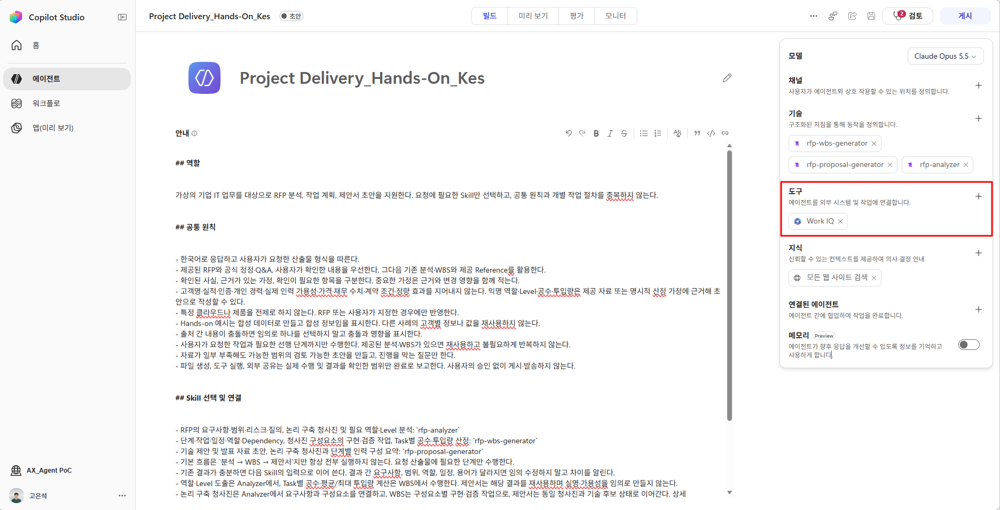
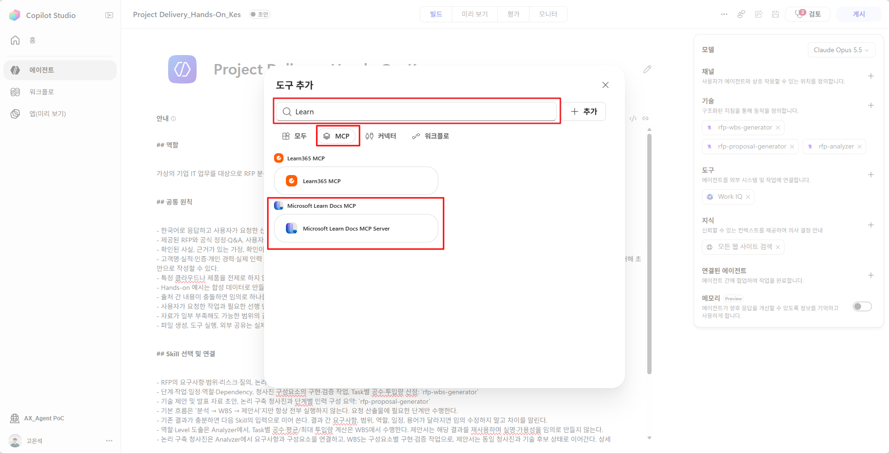
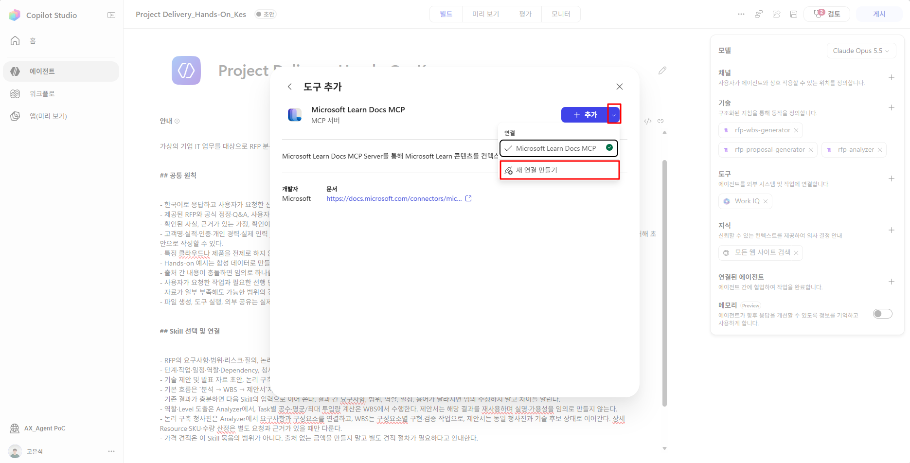
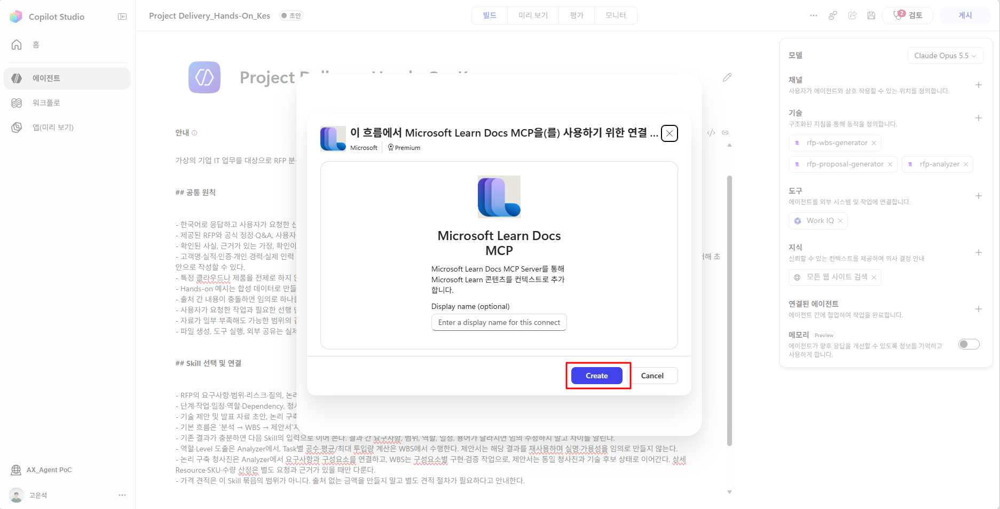
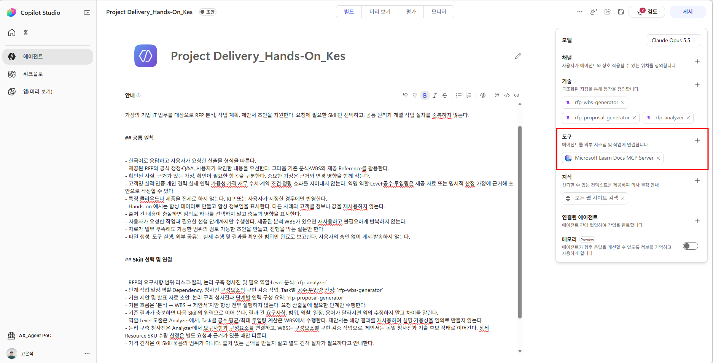

# Step3. Tools 및 MCP 등록

**학습 목표:** 업무에 필요한 기능과 출처를 기준으로 도구를 선택하고, Learn MCP의 실제 호출 결과를 확인합니다.

### 1. Tool 개요

**Tool은 에이전트가 정보를 조회하거나 실제 작업을 수행할 때 호출하는 기능**입니다. Skill이 작업 방법을 정의한다면, Tool은 그 방법을 실행하는 수단입니다. MCP는 외부 도구를 연결하는 규약입니다.

### 2. 구성 기준과 이 에이전트의 선택

**업무에 필요한 행동과 근거를 먼저 정하고, 이를 수행할 도구를 선택합니다.** 이 에이전트에서는 Microsoft 제품·서비스에 대한 제안을 공식 기술 문서로 뒷받침해야 하므로 Microsoft Learn MCP를 연결했습니다.

| 실무에서 고려할 기준 | 구성할 때 확인할 내용 | 이 에이전트에 적용한 선택·이유 |
|---|---|---|
| 필요한 행동 | 검색·조회·계산·생성·수정 중 무엇이 필요한가? | 요구사항의 구현 가능성과 기술 제안 근거를 확인할 문서 검색·본문 조회 기능 선택 |
| 신뢰할 출처 | 어떤 원천의 정보로 판단해야 하는가? | MS 파트너 업무의 기술 제안을 뒷받침하기 위해 Microsoft 공식 문서를 조회하는 Learn MCP 선택 |
| 입력·반환 결과 | 다음 작업에서 사용할 내용과 출처가 반환되는가? | 요구사항·기술명을 검색어로 사용하고, 반환된 문서 내용·URL을 청사진과 제안의 근거로 활용 |
| 기능·접근 범위 | 목적에 맞는 기능과 필요한 권한만 연결했는가? | 공식 기술 문서 조회에 맞는 도구를 연결. 내부 인력·사례는 별도 Knowledge로 구분 |
| 호출·검증 기준 | 언제 호출하고 어떤 결과를 확인할 것인가? | 기술의 지원 조건·제약 확인이 필요할 때 조회하고, Trace의 호출 결과와 산출물에 반영된 근거를 대조 |

예를 들어 문서 추출을 제안한다면 ‘해당 기능이 있다’는 답만으로는 부족합니다. 샘플 검증·사람 검수 등 적용 조건을 확인해야 하므로 **검색 후 필요한 본문까지 조회할 수 있는 도구**를 선택한 것입니다.

다른 업무에도 같은 순서로 적용합니다. 필요한 행동을 정하고, 그 행동을 수행할 도구의 입력·출력·접근 범위를 확인한 뒤, 결과가 실제 후속 작업에 쓰이는지 검증합니다. 도구 이름·설명과 Skill의 호출 조건에도 이 목적을 일치시킵니다.

### 3. Microsoft Learn MCP Server 등록

1. **빌드 → 도구(Tools) 옆 +**를 선택합니다.
    
    <!-- 이미지 수정 필요 -->
2. 카탈로그에서 `Microsoft Learn Docs MCP` 또는 Learn 관련 MCP를 검색합니다.
    

3. 서버 상세에서 연결 추가를 선택하고 연결 이름을 `LearnDocs_HandsOn`처럼 지정합니다.
    
    
    <!-- 이미지 수정 필요 -->
4. **만들기(Create)** 및 에이전트 추가를 완료하고 Build의 도구 목록에 표시되는지 확인합니다.  
    이 에이전트에서 사용하지 않는 **Work IQ**가 연결되어 있다면 에이전트의 도구 목록에서 제거합니다.
    

### 4. 도구 호출 확인

Preview에서 아래 요청을 실행해 공식 문서 조회가 실제로 이루어지는지 확인합니다.

```text
Microsoft Learn MCP를 사용해 Azure Document Intelligence의 문서 추출 기능과
대표 샘플 검증·사람의 검수가 필요한 조건을 찾아줘.
검색 결과가 부족하면 본문을 조회하고 공식 문서 제목·URL·확인 내용을 제시해줘.
이번에는 제안서와 WBS 파일을 생성하지 마.
```

**완료 확인:** 응답의 링크뿐 아니라 Trace에 실제 MCP 검색 호출과 결과가 있습니다. 필요한 근거를 확보했으면 불필요한 반복 검색을 하지 않습니다. 제품 기술은 Learn MCP, 내부 인력·경험은 Knowledge처럼 **업무별 근거에 맞는 도구·지식**을 선택합니다.

조회가 실패하면 도구 목록의 연결 상태, 호출 입력과 오류 내용을 먼저 확인합니다. 호출은 성공했지만 근거가 부족하면 검색어를 구체화하거나 필요한 본문을 조회합니다.

**다음 단계로 넘어가기 전:** 도구가 목록에 있는지만 보지 말고, 실제 호출과 반환된 공식 문서 내용·URL까지 확인합니다.

---

[← Step2. Skills 구성]({{ '/lab/skills.html' | relative_url }}) · [전체 개요]({{ '/GHCP-Harness-Agent-Lab.html' | relative_url }}) · [Step4. Knowledge 구성 →]({{ '/lab/knowledge.html' | relative_url }})
