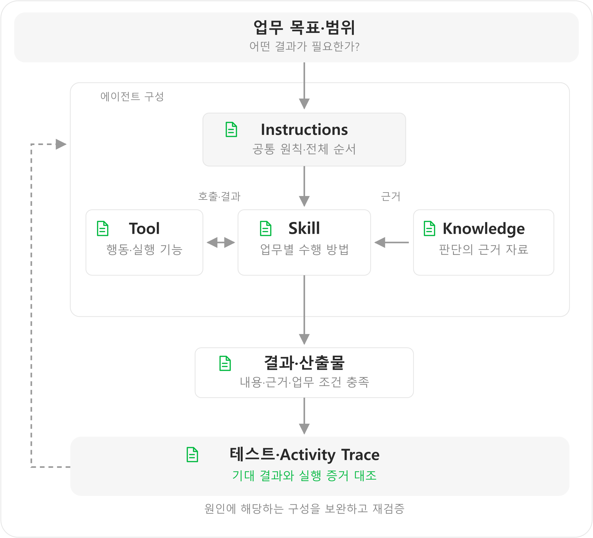

# Step6. 정리 및 마무리

{: .warning}
내용 검토용 초안: 실습 자료는 보완 중이므로 다운로드·참조 링크를 제외했습니다. 실습 자료 작업 완료 후 교안과 자료 링크를 수정하여 재배포할 예정입니다. 

RFP 분석·제안서·WBS 생성 사례를 통해 **업무를 나누고, 실행 기능과 근거 자료를 연결하고, 결과를 검증하며 개선하는 에이전트 구성 방법**을 살펴봤습니다. 같은 원칙을 다른 업무에도 적용할 수 있습니다.

### 1. 전체 구성 되짚기

*업무 목표에 맞춰 구성하고, 결과와 실행 근거를 확인해 개선합니다.*

이 에이전트의 업무 흐름은 **분석 → Draft WBS → 제안서 → 상세 WBS**입니다. Draft WBS는 중간 계획 데이터로 전달하며, 제안서와 상세 WBS에서 실제 파일을 생성합니다. 각 단계에서 요청 해석·계획·실행·검증·보완의 Agentic Loop가 동작합니다. GHCP는 이러한 다단계 흐름과 여러 Skill·도구 활용, PPTX·XLSX 작성 품질을 고려해 선택했습니다.

### 2. 각 구성에서 기억할 설계 기준

| 구성 | 핵심 기준 | 현재 에이전트에 적용한 방식 |
|---|---|---|
| [Instructions]({{ '/lab/agent-instructions.html' | relative_url }}) | 전체 목표·범위·공통 원칙·라우팅에 집중 | 필요한 Skill을 순서대로 연결하고 청사진·인력·일정의 일관성 유지 |
| [Skill]({{ '/lab/skills.html' | relative_url }}) | 하나의 명확한 업무와 완료 기준을 정의 | 분석·WBS·제안서를 분리하고 이전 결과를 재사용. 문서 생성은 동봉한 표준 양식을 복사해 작성·검증 |
| [Tool]({{ '/lab/tools-mcp.html' | relative_url }}) | 필요한 행동·입출력·원천·접근 범위를 기준으로 선택 | 공식 기술 근거를 검색·조회하기 위해 Learn MCP 연결 |
| [Knowledge]({{ '/lab/knowledge.html' | relative_url }}) | 필요한 판단 정보·자료의 역할·최신성·검색 범위를 확인 | 인력관리표로 실명 후보 추천, 기존 제안·WBS로 내용 참고. 공통·업무별 자료 구분 |
| [테스트·개선]({{ '/lab/testing.html' | relative_url }}) | 기대 동작과 실행 증거를 대조해 원인에 맞게 수정 | 정상·입력 부족·변경·오류 상황 확인 후 Trace로 문제 지점을 찾아 재검증 |

공통 원칙과 작업별 방법을 중복 작성하면 수정할 때 충돌하기 쉽습니다. **전체 업무의 연결은 지침에, 구체적인 수행 방법은 Skill에** 두고 Tool·Knowledge는 그 업무에 필요한 기능과 근거를 제공하도록 구성합니다.

### 3. 결과를 평가할 때 놓치지 않을 점

| 평가 기준 | 확인할 질문 |
|---|---|
| **근거** | 출처가 실제 판단을 뒷받침하는가? |
| **일관성** | 단계 간 ID·내용·상태가 유지되는가? |
| **업무 기준 충족** | 필요한 내용·형식·처리 조건에 맞는가? |
| **실제 완료** | 요청한 처리와 결과 제공을 실제로 확인했는가? |
| **수정·검증** | 원인에 맞게 수정하고 다시 확인했는가? |

예를 들어 파일 생성 업무라면 다운로드와 파일 열기를, 조회 업무라면 실제 조회 결과와 출처를 확인합니다.

### 4. 자신의 업무에 적용하기

여섯 영역의 질문을 바탕으로 자신의 업무 목표와 구성을 정리해 봅니다.

| ① 목표·범위 | ② 업무 분리 |
|---|---|
| 어떤 요청을 처리하고 어디까지 맡길까요? **정리할 내용:** 사용자 요청·기대 결과·제외 범위 | 독립된 목적과 완료 기준을 가진 작업은 무엇인가요? **정리할 내용:** 작업 목록·Skill별 책임 |

| ③ 입력·연결 | ④ 실행·근거 |
|---|---|
| 각 작업에 필요한 입력과 유지할 값은 무엇인가요? **정리할 내용:** 필수 입력·단계 간 전달 정보 | 어떤 기능과 자료가 필요한가요? **정리할 내용:** Tool·Knowledge와 사용 목적 |

| ⑤ 결과 조건 | ⑥ 검증·개선 |
|---|---|
| 어떤 결과를 받아야 업무에 쓸 수 있나요? **정리할 내용:** 결과 형식·필수 내용·양식 필요 여부 | 어떤 증거를 확인하고 어디를 고칠까요? **정리할 내용:** 정상·예외 상황·검증 기준·수정 영역 |

다른 입력에 대한 적용을 확인하려면 RFP-02 또는 RFP-03을 사용해 봅니다. 현재 대화의 결과를 그대로 반복하는지보다, **새 요구사항에 맞게 판단하면서도 정의한 역할·근거·완료 기준을 유지하는지** 확인합니다.

---

<nav class="lab-page-nav" aria-label="페이지 이동">
  <a class="lab-page-nav__prev" href="{{ '/lab/testing.html' | relative_url }}" rel="prev">이전</a>
  <a class="lab-page-nav__home" href="{{ '/' | relative_url }}">홈</a>
</nav>
